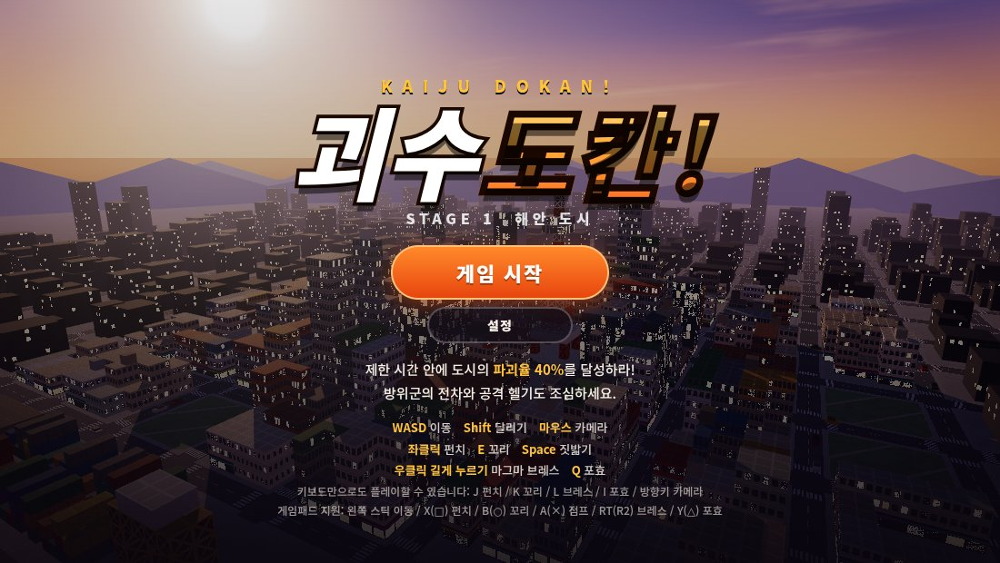
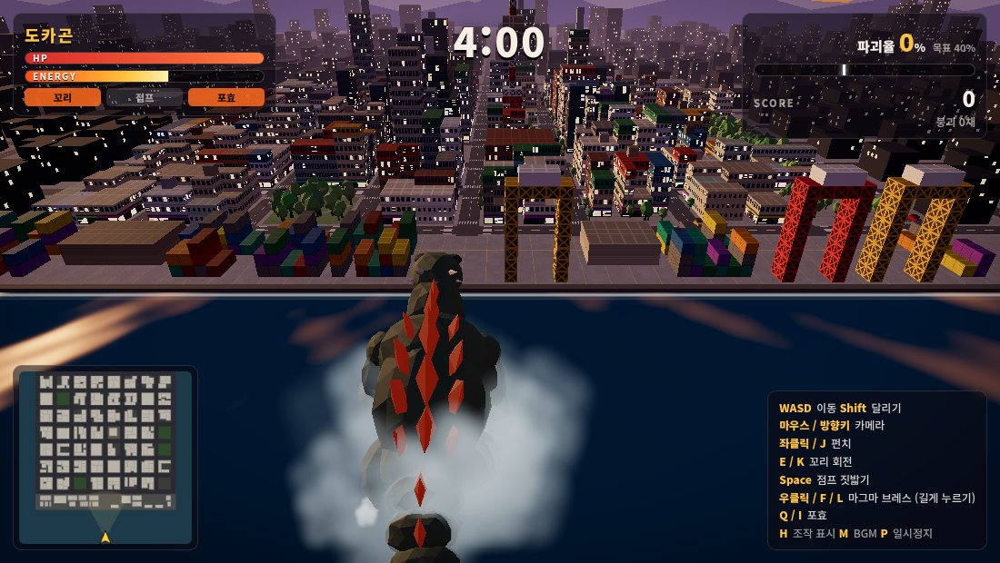
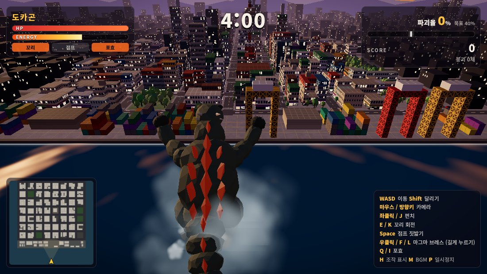
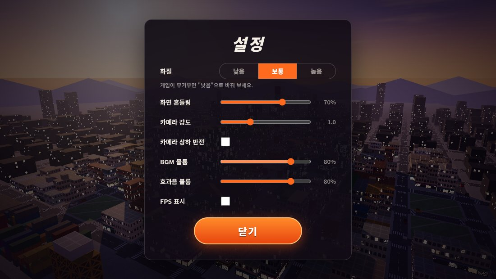

# 괴수 도칸! KAIJU DOKAN! (한글화)



거대 괴수 "도카곤"을 조종해 해 질 녘 해안 도시를 쾅쾅 부수는 3D 브라우저 게임 [kaiju-dokan](https://github.com/tanuu5/kaiju-dokan)(원작: たぬ, MIT 라이선스)의 **한국어 번역판**입니다.
Three.js + TypeScript로 만들어졌고, 그래픽, 효과음, BGM이 모두 코드로 생성되어 외부 이미지나 음원 파일이 없습니다.

**▶ 바로 플레이: https://sigco3111.github.io/kaiju-dokan-ko/**
(설치 없이 PC의 마우스+키보드, 게임패드, 스마트폰과 태블릿의 터치 조작으로 즐길 수 있습니다.)

## 주요 기능

- 제한 시간 4분 안에 도시 파괴율 40%를 달성하면 스테이지 클리어. 클리어 후에도 시간이 끝날 때까지 날뛰며 점수를 올릴 수 있습니다.
- 빌딩은 층 단위 블록으로 이루어져 있어 공격한 부분만 무너집니다. 기초를 무너뜨리면 빌딩이 쓰러지고, 높은 빌딩은 옆 건물을 휩쓸며 쓰러집니다.
- 파괴를 이어가면 콤보 배율이 최대 ×5까지 올라갑니다.
- 파괴로 에너지를 모으면 마그마 브레스를 쏠 수 있습니다.
- 시간이 지나면 방위군의 전차와 공격 헬기가 나타납니다. 짓밟기, 펀치, 꼬리, 브레스로 격파하고, 포효로 헬기를 주춤하게 만들 수 있습니다.
- 설정 화면에서 화질, 화면 흔들림, 카메라 감도, 상하 반전, 볼륨, FPS 표시를 바꿀 수 있습니다.

## 한글화 내용

- 타이틀, 일시정지, 설정, 결과 화면, HUD, 배너, 알림 메시지, 조작 안내, 오류 메시지를 모두 한국어로 번역했습니다.
- 파괴 의성어("쾅!", "와르르…" 등)와 건물 이름(도칸 타워, 도칸 돔 등)을 한국어로 바꿨습니다.
- 한글이 어디서나 깨지지 않도록 Noto Sans KR(SIL OFL) 글꼴을 함께 담았습니다.
- 게임 규칙, 밸런스, 조작 방식은 원작 그대로입니다.

## 실행 화면

| 플레이 | 마그마 브레스 |
| --- | --- |
|  |  |



## 조작 방법

| 조작 | 키보드+마우스 | 키보드만 | 게임패드 |
| --- | --- | --- | --- |
| 이동 / 달리기 | WASD / Shift | WASD / Shift | 왼쪽 스틱 / LB(L1) |
| 카메라 | 마우스 (화면을 클릭하면 마우스 조작으로 복귀) | 방향키 | 오른쪽 스틱 |
| 줌 | 마우스 휠 | - | - |
| 펀치 (연타하면 3타째는 내려치기) | 좌클릭 | J | X(□) |
| 꼬리 회전 공격 | E | K | B(○) |
| 점프 후 착지로 짓밟기 | Space | Space | A(×) |
| 마그마 브레스 (길게 누르기, 에너지 소모) | 우클릭 길게 누르기 / F | L | RT(R2) |
| 포효 (헬기 주춤, 차량 날려 버리기) | Q | I | Y(△) |
| 일시정지 | Esc / P | P | START |
| BGM 전환 / 조작 표시 전환 | M / H | M / H | - |

터치 기기에서는 화면 왼쪽을 드래그해 이동하고, 오른쪽을 드래그해 카메라를 조작하며, 오른쪽 아래 버튼으로 공격합니다.

## 설치 및 실행

Node.js 20.19 이상이 필요합니다.

```bash
npm install
npm run dev      # 개발 서버 (http://localhost:5173)
npm run build    # 타입 검사 + 프로덕션 빌드 (dist/)
npm test         # 단위 테스트 + 헤드리스 시뮬레이션
npm run sim      # 봇이 스테이지를 끝까지 플레이하는 밸런스 리포트
npm run check    # 타입 검사, 테스트, 빌드를 한 번에 실행
```

- URL 끝에 `?debug`를 붙이면 FPS 등 디버그 표시가 나오고, 브라우저 콘솔에서 `window.__game`에 접근할 수 있습니다.
- GitHub Pages 배포는 `.github/workflows/deploy.yml`(GitHub Actions)이 담당합니다.

## 기술 메모

- **건물**: 4m 크기 블록의 집합입니다. 도시 전체 블록을 하나의 InstancedMesh로 그리고, 파괴, 지지 판정, 붕괴를 CPU에서 계산합니다.
- **그래픽**: 창문, 도로, 하늘, 바다를 셰이더로 생성하고, 석양 조명에 블룸을 얹었습니다. 괴수가 빌딩에 가려지면 스텐실로 투시 실루엣을 보여 줍니다.
- **사운드**: 발소리, 폭발, 붕괴, 포효, BGM을 Web Audio API로 합성합니다.
- **사용 기술**: Three.js, TypeScript, Vite, Vitest
- 번역 대상 문자열은 `index.html`, `src/game/`, `src/stages/`, `src/world/cityGen.ts`, `src/main.ts`에 있습니다.

## 라이선스 및 원작 크레딧

- 원작: [tanuu5/kaiju-dokan](https://github.com/tanuu5/kaiju-dokan) © 2026 たぬ, [MIT License](LICENSE). 원작 README에 따르면 Claude Code(모델: Claude Opus 5.5)로 개발되었습니다.
- 이 한국어판도 같은 MIT 라이선스를 따릅니다. 번역: sigco3111.
- 번들 글꼴: [Noto Sans KR](https://fonts.google.com/noto/specimen/Noto+Sans+KR) (SIL Open Font License 1.1, `@fontsource/noto-sans-kr`).
